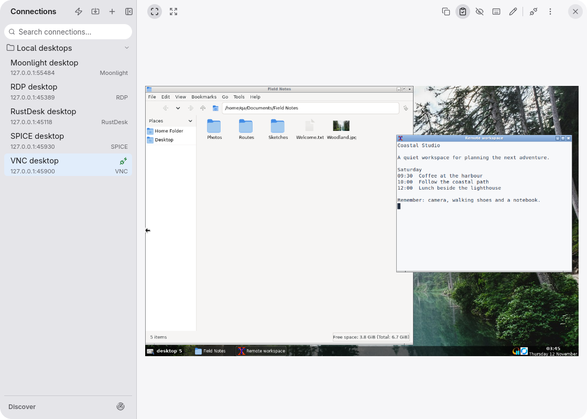
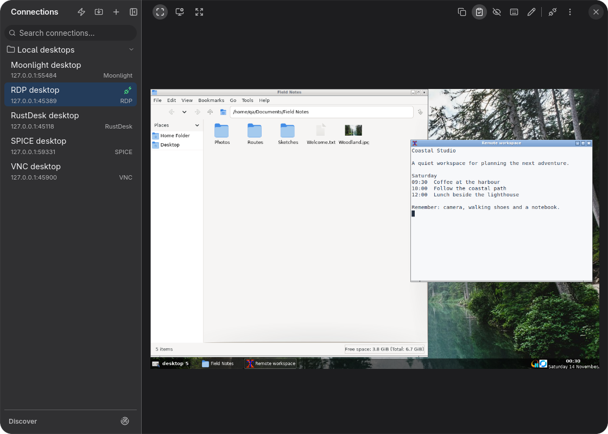
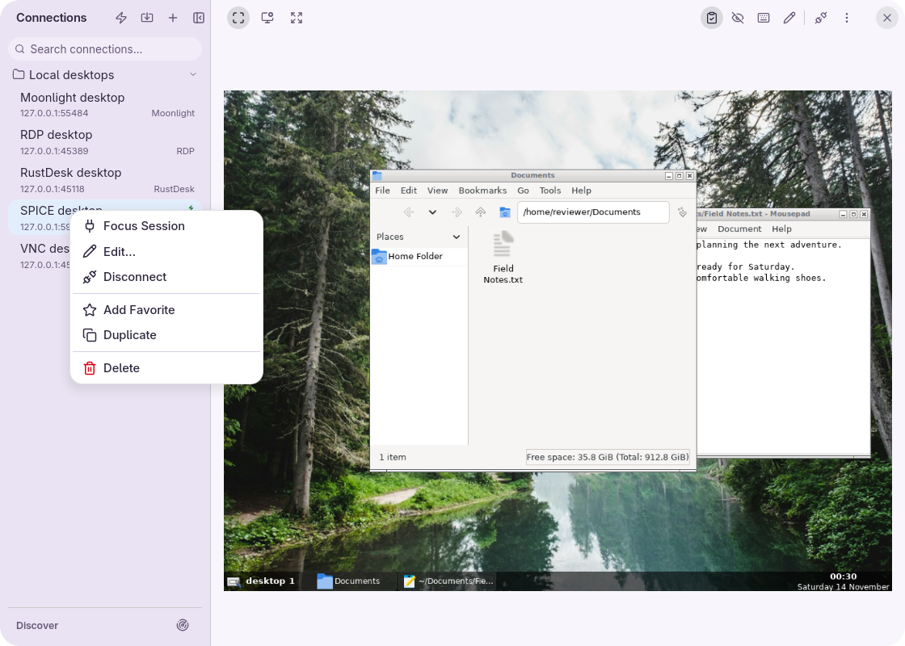
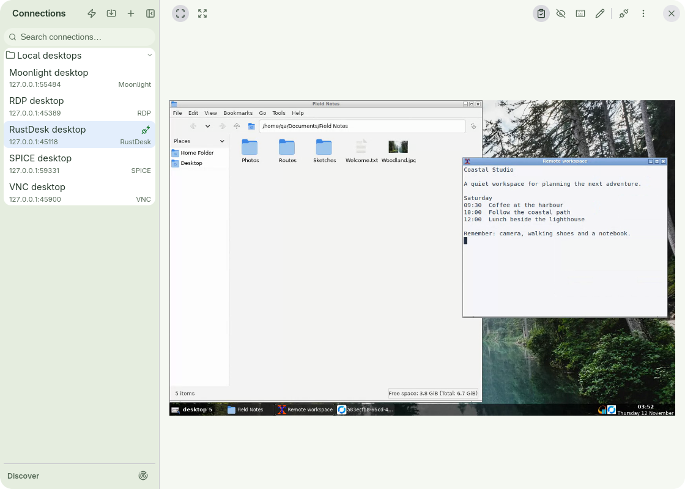
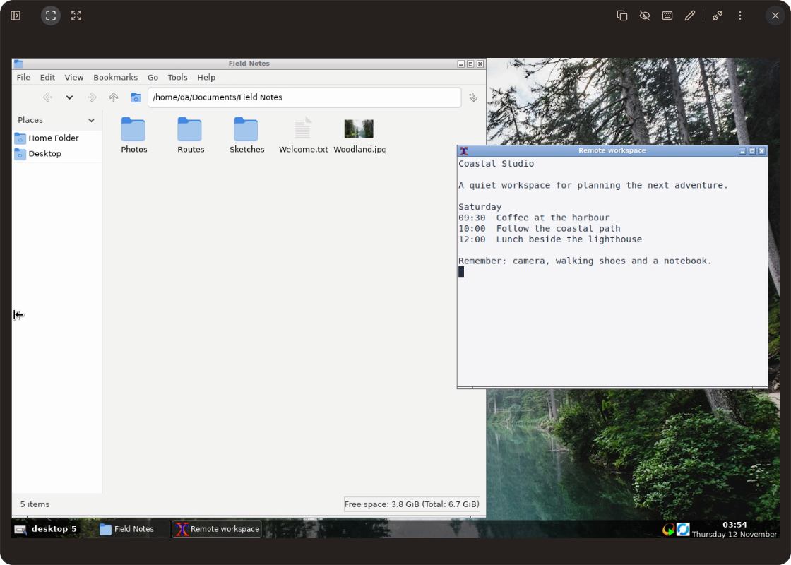
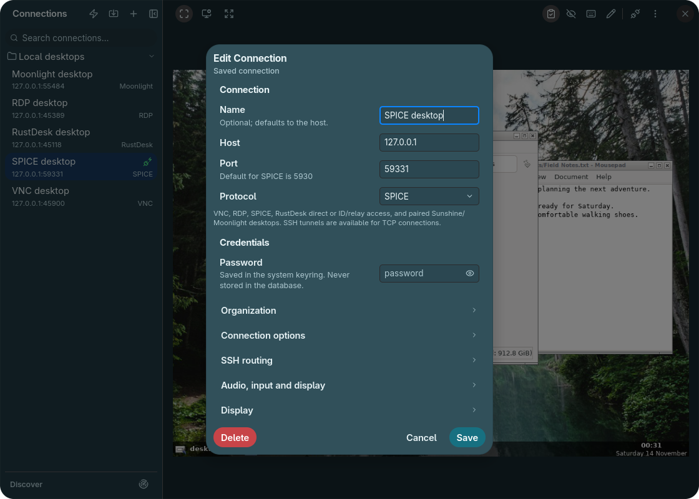
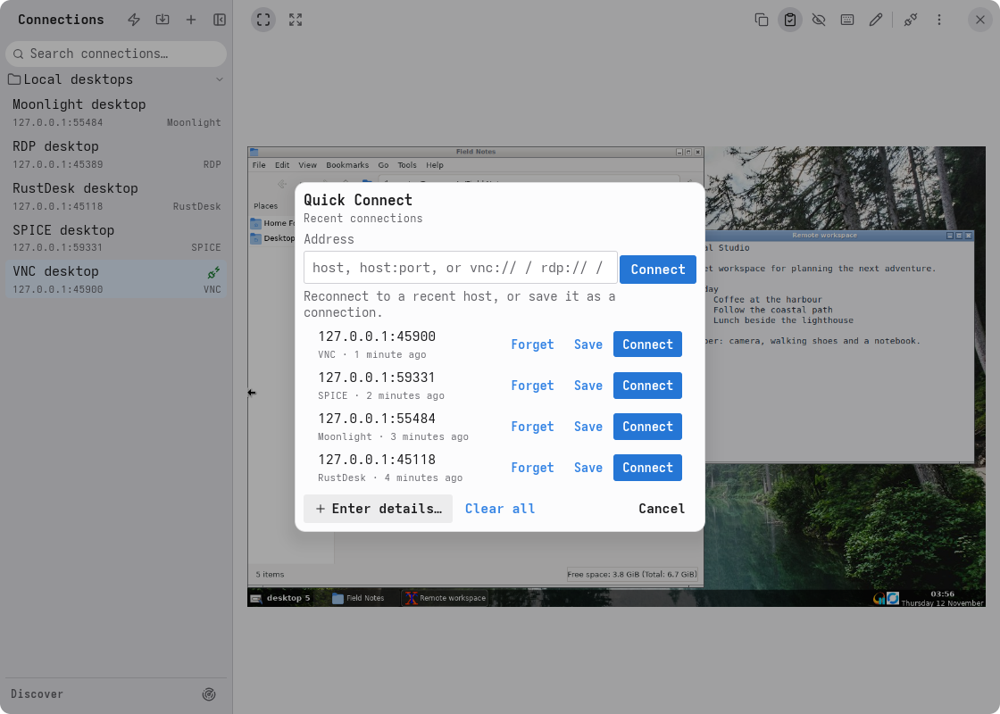
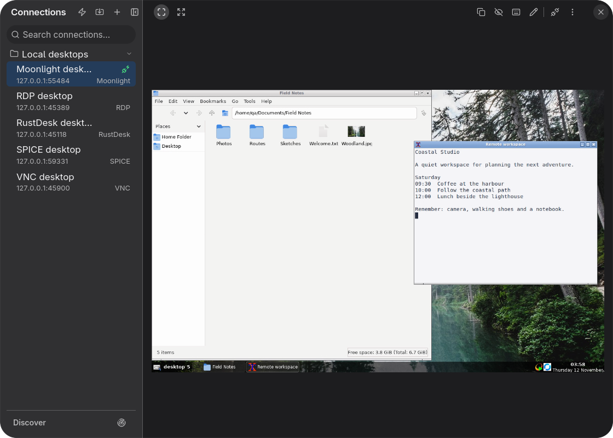

# Remote

A native remote connection manager built with [enzUI](https://github.com/enz1m/enzui).
Work with embedded remote desktops, with saved profiles, folders
and per-host connection settings.

<table>
  <tr>
    <td align="center"><a href="docs/screenshots/basic-light.png"></a><br><sub>VNC desktop · light</sub></td>
    <td align="center"><a href="docs/screenshots/basic-dark.png"></a><br><sub>RDP desktop · dark</sub></td>
    <td align="center"><a href="docs/screenshots/lavender.png"></a><br><sub>SPICE · connection actions</sub></td>
    <td align="center"><a href="docs/screenshots/sage.png"></a><br><sub>RustDesk desktop</sub></td>
  </tr>
  <tr>
    <td align="center"><a href="docs/screenshots/ember.png"></a><br><sub>Moonlight desktop</sub></td>
    <td align="center"><a href="docs/screenshots/lagoon.png"></a><br><sub>SPICE · connection settings</sub></td>
    <td align="center"><a href="docs/screenshots/precision.png"></a><br><sub>VNC · Quick Connect</sub></td>
    <td align="center"><a href="docs/screenshots/comfort.png"></a><br><sub>Moonlight · spacious layout</sub></td>
  </tr>
</table>

Click a screenshot to enlarge. Screenshots show disposable local Linux desktops
and test files, with wallpaper from [Unsplash](https://unsplash.com/license).

## Features

- Embedded VNC, RDP, SPICE, RustDesk and Moonlight desktops.
- SSH tunnels for VNC, RDP, SPICE and RustDesk, using OpenSSH keys or an agent.
- Saved profiles, flat folders, favorites, search and Quick Connect history.
- Native profile import/export, Secret Service credentials and strict host trust.
- Desktop input, view-only mode, keyboard release, text clipboard and PNG captures.
- Live light/dark themes, system/theme fonts and partial German/Arabic translations.

| Protocol | Implemented | Important limits |
| --- | --- | --- |
| VNC | RFB 3.8, Raw/CopyRect/ZRLE, classic authentication and verified X509 TLS | No Tight/JPEG, audio or file clipboard |
| RDP | TLS/NTLM NLA, 32-bit graphics, text clipboard, PCM playback and optional dynamic resize | No gateway, Kerberos, RemoteApp or device redirection |
| SPICE | Embedded display/input, upstream audio playback, guest-agent text clipboard and optional resizing | One primary display; no microphone controls, USB, shared folders or GL scanout |
| RustDesk | Direct hosts and signed ID/relay connections, video, audio and text clipboard | No file transfer, multi-display composition or account/address-book features |
| Moonlight | Paired Sunshine streaming, video/audio, input and optional controller forwarding | Server/codec/device support varies; explicit clipboard typing only, no clipboard synchronization or general file transfer |


SSH terminals belong in Terminal and SFTP file browsing in Files. Moonlight uses UDP
and requires a VPN rather than ordinary SSH forwarding.

See [protocol contracts and limits](docs/PROTOCOLS.md) for negotiation, media,
input, resize and clipboard details. Imported profiles do not imply support for
every option of their original client.

## Build and run

Use Rust **1.99.1**; the minimum supported version is **1.95**. Native builds need
Git, a C/C++ compiler, pkg-config, CMake, libclang, SQLite prerequisites,
SPICE client GLib 0.42+ development files, GLib/GIO, Opus, SDL2, OpenSSL and libsodium.
Wayland/XKB and Vulkan/EGL are required by the UI. Install GStreamer 1.20+ with
the base, good, bad and libav plugin sets for desktop video/audio decoding.
OpenSSH supplies the desktop tunnels.

```sh
git clone https://github.com/enz1m/remote.git
cd remote
cargo fetch --locked
cargo build --locked
cargo run --locked
```

Use `cargo build --release --locked` for an optimized binary.

The app pins public [enzUI Alpha 0.2](https://github.com/enz1m/enzui/releases/tag/v0.2.0-alpha.1)
and its matching public foundation forks. No sibling framework checkout or manual
submodule setup is required. Wayland is the default; add `--features x11` for X11.
Optional `--features center` enables the enrolled enzUI Center connector.

SPICE links to the normal upstream `spice-client-glib-2.0` system library;
Remote uses no SPICE fork or private native build and does not link to GTK widgets.
Upstream SpiceAudio handles playback and any guest-requested recording using the
local sound system. The connection's Audio setting disables audio channels;
there is no separate microphone control.

Moonlight is pinned to the reviewed [Rust wrapper fork](https://github.com/enz1m/enzim-moonlight-common-rust),
which uses official Moonlight Common-C sources for streaming. Cargo fetches its
native submodules automatically. IronRDP uses published component crates,
including session 0.13.0, with no local patches.

## Opening connection files

Remote imports `.rdp`, `.remmina` and its own JSON profile exports. Open a file
with the import action, a command-line path or Linux “Open With”:

```sh
cargo run --locked -- /path/to/connection.rdp
```

File and file-URI launches import into the existing window; multiple files are
processed in order. They never start a connection automatically. Imports are
bounded, run off the UI thread, exclude passwords and report unsupported fields.
The [desktop entry](assets/io.github.enzui.Remote.desktop) and
[MIME definitions](assets/io.github.enzui.Remote.xml) register RDP, Remmina and
Remote JSON exports (`remote-app-profiles.json` or `*.remote.json`). Other JSON
filenames can still be imported or passed directly. Registration does not change
default associations.

For an existing-screen RDP bridge, set the requested width and height to the host
desktop size. Changing the guest resolution requires server support; local image
scaling is independent.

## Profiles and interaction

Profiles live in `$XDG_DATA_HOME/enzui-remote/connections.db`, normally
`~/.local/share/enzui-remote/connections.db`. Ordinary startup keeps an empty
library empty. `REMOTE_APP_DB_PATH` selects disposable state for development.
Passwords use Secret Service and are excluded from SQLite and profile exports.

Click inside a desktop to direct input to it. **Ctrl+Alt+Shift+Escape** releases
capture; focus loss releases pressed keys and buttons. Text clipboard sharing
requires an interactive, captured session with sharing enabled. File and rich
clipboard formats are unavailable. Unencrypted VNC and RustDesk outside loopback require explicit acknowledgement.
SPICE requires TLS outside loopback. TLS never accepts an untrusted certificate
or silently downgrades. SSH uses OpenSSH host-key verification.

File transfer belongs in Files; desktop-viewer file drops are unavailable.
The shared enzUI theme and `io.github.enzui.Remote` override
apply live. Default shortcuts include Ctrl+N for a saved profile, Ctrl+K for Quick
Connect and Ctrl+/ for keyboard help, while the desktop does not own input.

## Development

```sh
cargo fmt --all -- --check
ICED_TEST_BACKEND=software cargo test --locked --all-targets --all-features -- --test-threads=1
cargo clippy --locked --all-targets --all-features -- -D warnings
```

Native integration tests run sequentially because they exercise shared GLib/SDL
state. Use disposable servers for live checks; fixture success does not qualify
every server, codec or device. See [contributing](CONTRIBUTING.md).

Licensed under [AGPL-3.0-or-later](LICENSE). Preserved original notices are in
[LICENSES](LICENSES/); dependencies retain their own licenses in their source repositories.
